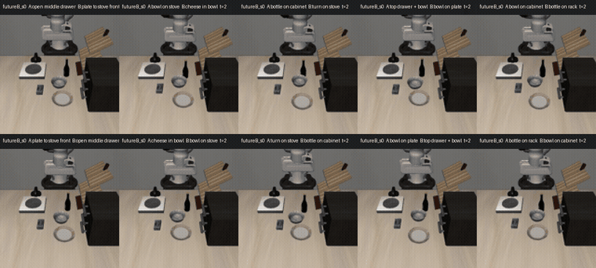
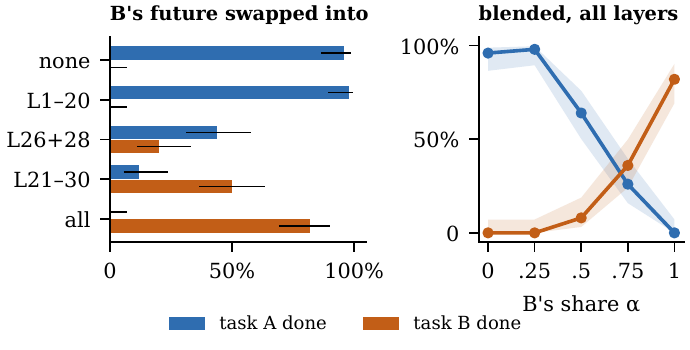
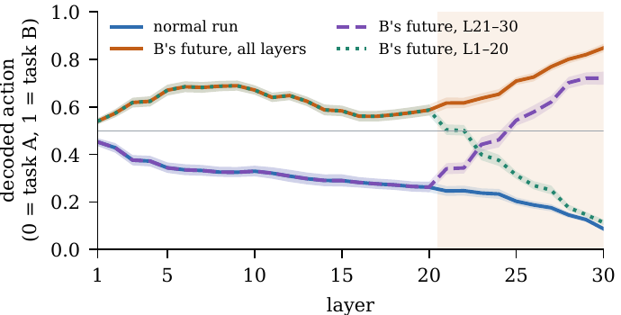

# Do World Action Models Act on What They Imagine?

**Causal evidence from patching the imagined future**

Tushar Bajaj · Indian Institute of Technology Bombay · [23b2107@iitb.ac.in](mailto:23b2107@iitb.ac.in)

[Paper (PDF)](paper/Bajaj_WAM_imagination.pdf) · arXiv: coming soon

<p align="center">
  
</p>
<p align="center"><sub>Closed loop, LIBERO-Goal. Every robot is <b>told task A</b>, but at every decision the imagined future in its
cache is replaced by the one imagined for <b>task B</b>. The caption turns orange when B's goal is reached.</sub></p>

## TL;DR

World action models (WAMs) imagine a short video of the future and then act. Do they actually use what they imagine?
We open [Fast-WAM](https://github.com/yuantianyuan01/FastWAM) and swap its imagined future inside the key/value cache
that the action transformer reads.

- **The action follows the imagined future.** Swapping in another task's imagined future changes the action 40x the
  noise floor and moves it to that task's action; swapping the current frame barely matters.
- **The robot does what it imagines, not what it is told.** Told A while imagining B, the robot completes **B in 113 of
  150** closed-loop episodes and A in 4. Told B while imagining A, it does A (94%) and never B.
- **It does not need the imagination, but follows it when present.** With imagination switched off (first-frame
  mode), it completes A in 145 of 150 episodes, as often as normal (147), so success rates alone hide this dependence.
- **The last ten layers decide.** Swapping only layers 21-30 suppresses A (12%) and produces B (50%); layers 1-20 do
  nothing (98% A), even though attention to the future peaks around layer 20.
- **Early layers read, late layers decide.** A tuned action lens shows early layers already encode B, but layers 21-30
  overwrite them when they disagree.
- **What is read:** the tokens where the two imagined futures differ (wrist camera more than main camera), through a
  handful of heads.

| Closed loop (10 tasks x 5 starts x 3 seeds) | Task A done | Task B done |
|---|---|---|
| Normal (imagine A, told A) | 147 / 150 | 0 / 150 |
| Imagination off (first-frame mode, told A) | 145 / 150 | 0 / 150 |
| Swap instruction (imagine A, told B) | 141 / 150 | 0 / 150 |
| **Swap imagination (imagine B, told A)** | **4 / 150** | **113 / 150** |

<p align="center">
  
  
</p>

## How it works

Fast-WAM's Optional-IDM checkpoint (Wan2.2-TI2V-5B video transformer + 1B action transformer, 30 layers each) imagines
a future clip, runs the video transformer once more over it to fill a per-layer key/value cache (98 current-frame
tokens + 196 imagined-future tokens), and denoises 32 actions while action layer *l* attends to cache layer *l*.
We overwrite the future slots of chosen layers with those computed from another task's imagination,

```
K~_l[F] = (1 - alpha) K^A_l[F] + alpha K^B_l[F],   l in S      (same for V)
```

keeping the current frame, the instruction and the action noise unchanged. The split pipeline reproduces the official
inference bit for bit before any edit.

## Repository layout

```
wam/
  wamlib.py              split Fast-WAM inference: imagine -> prefill (KV cache) -> act; cache editing helpers
  sim.py                 LIBERO closed-loop episodes with cache edits; B's goal checked on the same sim state
  step0.py               validation: weights, cache shapes, bit-identical reproduction, timing
  pilot_future_swap.py   open loop: replace the future (other task / mean / noise / static / knockout), layer bands,
                         single layers, attention recording
  flip_test.py           closed loop: clean / futureB (swap imagination) / textB (swap instruction) /
                         noimagine (first-frame mode), --layers, --alpha
  phase2.py              mechanism: partial-future swaps, single heads, raw and tuned action lens
  analyze_*.py           laptop-side analysis (bootstrap and Wilson intervals)
  render_videos.py       npz frames -> captioned mp4 grids
  modal_app.py, launch.py  run any script on a Modal L40S GPU
  results/               per-episode rows (*.jsonl) and summaries (*.json) for every run in the paper
setup/                   download the pinned checkpoint and assets into Modal volumes
paper/                   LaTeX source, make_figs.py (all figures and numbers from wam/results), PDF
assets/                  README figures, closed-loop videos (assets/videos/*.mp4)
```

## Reproducing

All model code runs on one NVIDIA L40S (48 GB) through [Modal](https://modal.com); the laptop only launches jobs and
analyses results. Peak GPU memory is 25.5 GB in bf16, so any 32 GB+ GPU should work if you adapt `modal_app.py`.

```bash
# 1. Code dependencies
git clone https://github.com/yuantianyuan01/FastWAM third_party/FastWAM
git -C third_party/FastWAM checkout 7faa71108368fbb3b6885649f112af607427a2d4
pip install -r requirements.txt && modal setup

# 2. Checkpoint (yuanty/fastwam @ 8eaceeb, SHA-256 checked) and assets (Wan2.2 VAE, umT5, LIBERO-Goal) into volumes
modal run setup/download_ckpt.py
modal run setup/download_assets.py

# 3. Validation
modal run wam/modal_app.py --script step0

# 4. Open loop on training frames (one run per seed)
modal run wam/modal_app.py --script pilot_future_swap --args "--eps-per-task 2 --t-per-ep 5 --seed 0 --single-layer --attn"

# 5. Closed loop (LIBERO-Goal, 10 tasks x 5 starts); add --seed 0 / --seed 1 for the other seeds
modal run wam/modal_app.py --sim --script flip_test --args "--cond clean --inits 5 --save-states"
modal run wam/modal_app.py --sim --script flip_test --args "--cond textB --inits 5"
modal run wam/modal_app.py --sim --script flip_test --args "--cond futureB --inits 5"
modal run wam/modal_app.py --sim --script flip_test --args "--cond noimagine --inits 5 --file noimagine_s42.jsonl"
modal run wam/modal_app.py --sim --script flip_test --args "--cond futureB --inits 5 --layers 21-30 --file futureB_L21-30.jsonl"
modal run wam/modal_app.py --sim --script flip_test --args "--cond futureB --inits 5 --alpha 0.5 --file futureB_a0.5.jsonl"

# 6. Open loop on fresh states saved by the clean closed-loop run
modal run wam/modal_app.py --script pilot_future_swap --args "--source rollouts --per-ep 2 --seed 0 --single-layer --attn --tag rollouts_s0"

# 7. Mechanism: partial swaps, heads, action lens
modal run wam/modal_app.py --script phase2 --args "--per-ep 2 --seed 0 --tag s0"
modal run wam/modal_app.py --script phase2 --args "--lens-only --lens-bands all,L21-30,L1-20 --tag lens3"

# 8. Analysis and paper figures (laptop)
python wam/analyze_flip.py wam/results/phase1/flip_test
python paper/make_figs.py
```

Long closed-loop runs are easier through the deployed app (`modal deploy wam/modal_app.py`, then
`python wam/launch.py --sim flip_test "<args>"`), which keeps running if your laptop sleeps.

Everything in `paper/figs/numbers.tex` (every number in the paper) is regenerated by `paper/make_figs.py` from the
files in `wam/results/`. Large tensors (action-lens arrays, attention records, saved simulator states) are not
included because of their size; they are available on request.

## Citation

```bibtex
@article{bajaj2026wamimagine,
  author  = {Tushar Bajaj},
  title   = {Do World Action Models Act on What They Imagine? Causal Evidence from Patching the Imagined Future},
  journal = {arXiv preprint},
  year    = {2026}
}
```

## Acknowledgements

Built on [Fast-WAM](https://github.com/yuantianyuan01/FastWAM) (MIT), [Wan2.2](https://github.com/Wan-Video/Wan2.2)
and [LIBERO](https://github.com/Lifelong-Robot-Learning/LIBERO); the code here uses them unmodified. Experiment code,
analysis and an initial draft of the paper were prepared with assistance from an AI system (Claude, Anthropic); the
author reviewed all of it and takes full responsibility.

## License

MIT. See [LICENSE](LICENSE).
